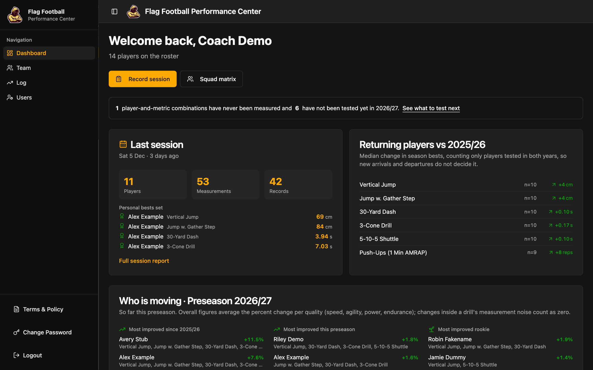
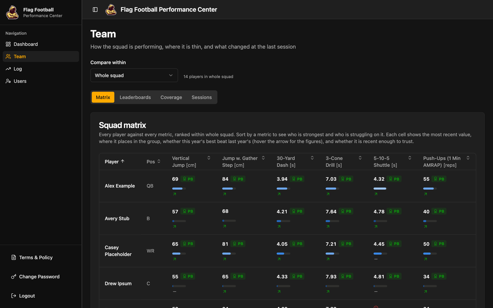
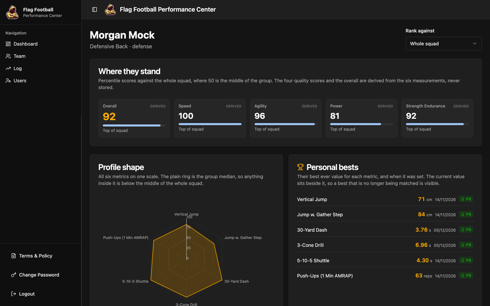
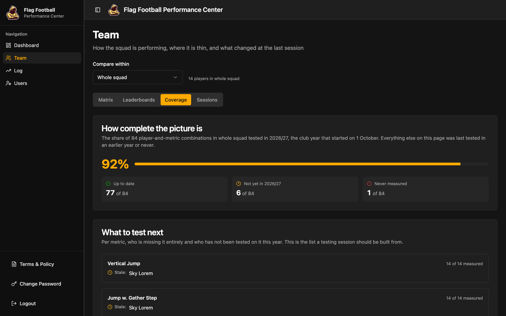
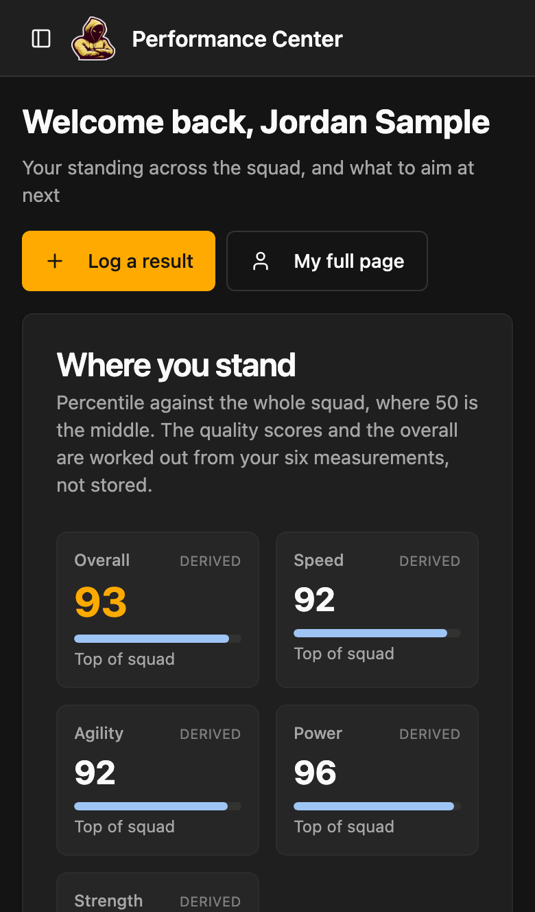
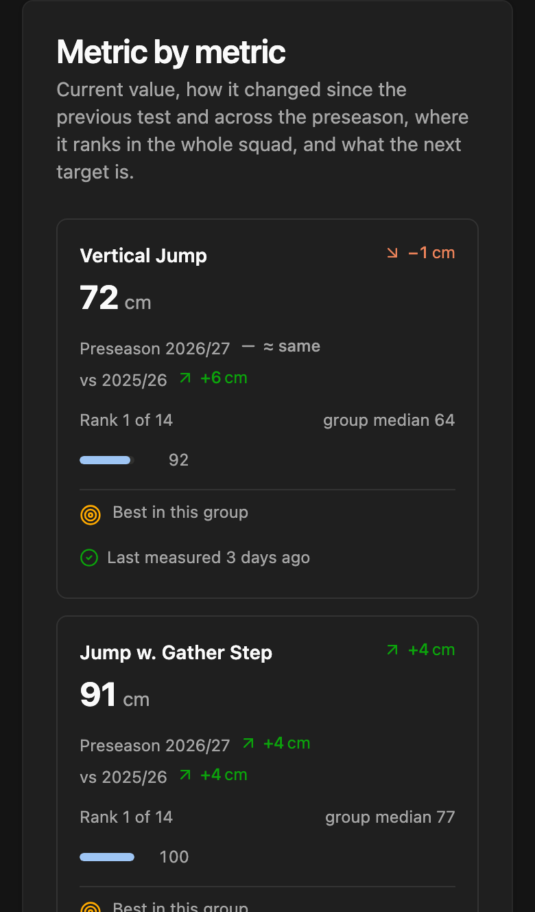
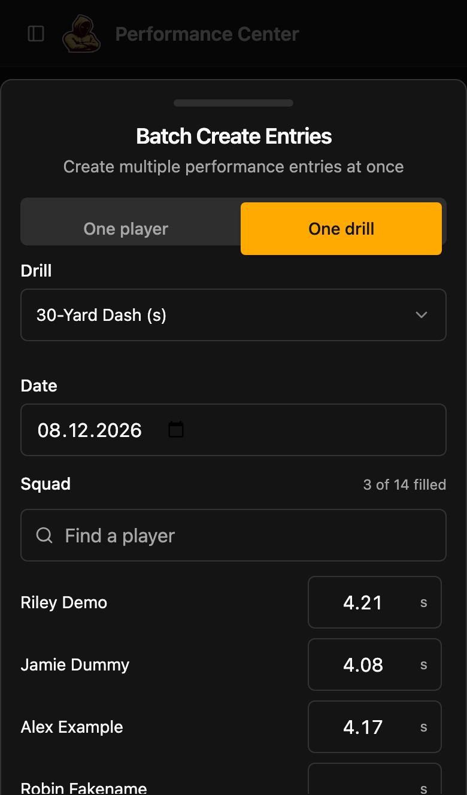
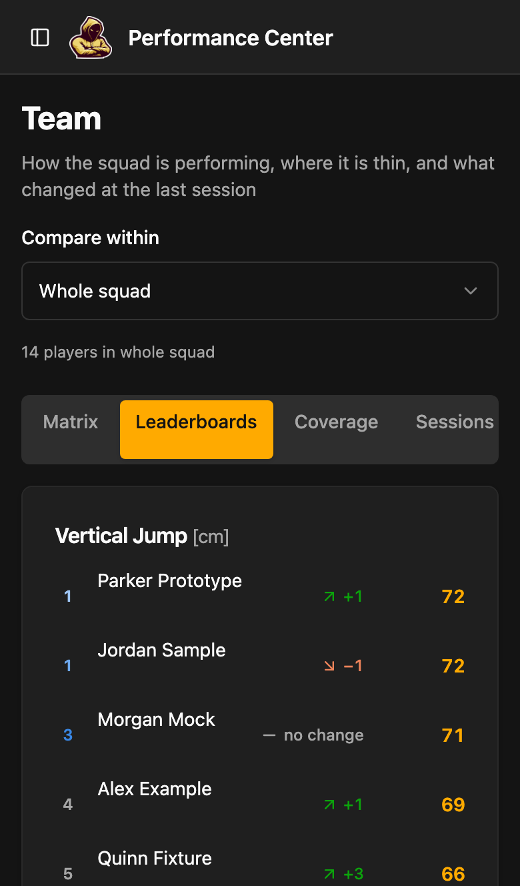

# Renegades Performance

The performance center of the Nürnberg Renegades e.V. flag football club. Coaches record
combine-style testing days at the pitch; the app turns them into a squad matrix,
leaderboards, season-on-season progress and a page per player. Players see where they
stand and what to aim at next, without seeing anyone else's numbers.

<table>
  <tr>
    <td width="50%"></td>
    <td width="50%"></td>
  </tr>
  <tr>
    <td></td>
    <td></td>
  </tr>
</table>

<table>
  <tr>
    <td width="25%"></td>
    <td width="25%"></td>
    <td width="25%"></td>
    <td width="25%"></td>
  </tr>
</table>

<sub>Every name and number in these screenshots is invented. They are generated by
[`scripts/readme-screenshots.ts`](./scripts/readme-screenshots.ts) against a mocked
backend; see [Screenshots](#screenshots).</sub>

## Features

### For coaches and admins

- **Dashboard.** The last session at a glance (players, measurements, personal bests),
  how returning players compare with last year, and *who is moving* this preseason: most
  improved since last year, most improved this preseason, rookies ranked on their own,
  records, and a "check in with" list of drops bigger than measurement noise.
- **Team** (`/team`), scoped to the whole squad, offense/defense or a single position:
  - *Matrix*: every player against every metric, sortable, with percentile, personal-best
    badge and a year-over-year arrow in each cell.
  - *Leaderboards*: per metric, with the change since each player's previous test, plus
    two derived boards, gather gain and agility-to-speed ratio.
  - *Coverage*: how much of the squad has been tested this club year, and per metric who
    is stale or has never been measured. A testing day can be planned from this list.
  - *Sessions*: every testing day, each with a report of who attended and which personal
    bests were set.
- **Record session.** Enter a testing day one player at a time, or one drill across the
  whole roster, which is how it actually happens at the pitch.
- **Log.** Every measurement on file, sortable and filterable, with edit and delete.
- **Users** (admins only). Create accounts, assign roles and positions, reset passwords.
  Removing a member who has results anonymises them by default: the account, name and
  position are deleted, and the results stay in the history as "Former player 3f2a".
  "Delete everything" removes the results too.

### For players

- **Dashboard and My page** (`/me`). Percentile standing against the squad, unit or
  position; derived scores for speed, agility, power and strength endurance; personal
  bests; this preseason's change and the change against last year; and the next target
  value to beat. Teammates' names are withheld server-side.
- Players can log their own results, and edit or delete only those.

### For everyone

- Usable on a phone at the pitch: responsive layout, bottom-sheet dialogs, routes loaded
  on demand.
- Terms & Policy (EN/DE) must be accepted at first sign-in, and again whenever they change
  in substance.

### Metrics

Defined once in [`src/lib/metrics.ts`](./src/lib/metrics.ts) and mirrored for the edge
functions in [`supabase/functions/_shared/metrics.ts`](./supabase/functions/_shared/metrics.ts).

| Metric | Unit | Better | Meaningful change |
|---|---|---|---|
| Vertical Jump | cm | higher | 2 cm |
| Jump w. Gather Step | cm | higher | 2 cm |
| 30-Yard Dash | s | lower | 0.05 s |
| 3-Cone Drill | s | lower | 0.10 s |
| 5-10-5 Shuttle | s | lower | 0.08 s |
| Push-Ups (1 Min AMRAP) | reps | higher | 2 reps |

A change smaller than the *meaningful change* reads as "≈ same" and does not count in
rankings, so the improvement lists rank real progress instead of timing noise. These are
starting values for electronic timing gates and are meant to be tuned by the coaches.

### The club year

The squad is tested in bursts: two or three sessions each preseason (November to January),
then nothing until the next November. Comparisons therefore follow the **club year**, which
turns over on **1 October**. Offseason 26, Preseason 26/27 and Season 27 are all "2026/27"
([`src/lib/clubYear.ts`](./src/lib/clubYear.ts), [`src/lib/seasons.ts`](./src/lib/seasons.ts)).

- *Season gain*: the year's first test against the best one after it.
- *Year over year*: this year's best against last year's best.
- "Up to date" means tested this club year. Until the first test of a new year, the
  dashboard shows last year's recap.

## Running it locally

You need **Node 24+** (see [`.nvmrc`](./.nvmrc)) and **pnpm**, which is pinned by the
`packageManager` field in [`package.json`](./package.json). Run `corepack enable` once
and the right pnpm version is used automatically.

```sh
git clone https://github.com/nbg-renegades/renegades-performance.git
cd renegades-performance
corepack enable
pnpm install
cp .env.example .env    # then fill in a backend, see below
pnpm dev                # http://localhost:8080
```

[`pnpm-workspace.yaml`](./pnpm-workspace.yaml) sets `minimumReleaseAge` to 5 days, so a
newly published package version is not installed until it has been out long enough for a
compromised release to be noticed.

### Choosing a backend

`.env` needs three values: `VITE_SUPABASE_PROJECT_ID`, `VITE_SUPABASE_URL` and
`VITE_SUPABASE_PUBLISHABLE_KEY`.

> [!WARNING]
> [`.env.example`](./.env.example) points at the **production** project. There is no
> staging project, so with those values a local `pnpm dev` reads and writes the club's
> real data. Use a local stack for anything but looking.

**Local Supabase stack (recommended).** Requires Docker and the
[Supabase CLI](https://supabase.com/docs/guides/local-development/cli/getting-started).

```sh
supabase start        # starts Postgres, Auth and the API, and applies every migration
supabase status       # prints the API URL, anon key and service-role key
```

Put the API URL in `VITE_SUPABASE_URL` and the anon key in
`VITE_SUPABASE_PUBLISHABLE_KEY`; any value works for `VITE_SUPABASE_PROJECT_ID`.

A fresh stack has no users, and accounts are normally created by an admin from within the
app. Create the first admin directly, using the service-role key from `supabase status`:

```sh
API=http://127.0.0.1:54321
KEY=<service role key>

# Sign-in turns the username "coach.demo" into the email coach.demo@team.local.
curl -s -X POST "$API/auth/v1/admin/users" \
  -H "apikey: $KEY" -H "Authorization: Bearer $KEY" -H "Content-Type: application/json" \
  -d '{"email":"coach.demo@team.local","password":"change-me-123","email_confirm":true,
       "user_metadata":{"first_name":"Coach","last_name":"Demo"}}'

# Make them an admin, using the "id" printed above.
curl -s -X POST "$API/rest/v1/user_roles" \
  -H "apikey: $KEY" -H "Authorization: Bearer $KEY" -H "Content-Type: application/json" \
  -d '{"user_id":"<id>","role":"admin"}'
```

Sign in as `coach.demo`. Creating further users, resetting passwords and the player
standing all go through edge functions, so run `supabase functions serve` alongside to use
those parts of the app.

### Scripts

| Command | What it does |
|---|---|
| `pnpm dev` | Dev server on <http://localhost:8080> |
| `pnpm build` | Production build into `dist/` |
| `pnpm preview` | Serves the production build |
| `pnpm typecheck` | Full TypeScript check (`tsc -b --force`) |
| `pnpm lint` | ESLint |
| `pnpm test` | Playwright suite: unit tests, plus smoke tests on desktop and a Pixel 7 |
| `pnpm test:ui` | The same in Playwright's inspector |

TypeScript is deliberately held at 6.x, because TypeScript 7 breaks `typescript-eslint`.

### Tests

`pnpm test` runs [`tests/`](./tests) with Playwright. The `*.unit.spec.ts` files test the
pure modules in `src/lib` (analytics, seasons) without opening a page. The smoke suite
signs in by seeding a session into localStorage and answers every Supabase request from
[`tests/fixtures.ts`](./tests/fixtures.ts), as an admin and as a player. It needs no
backend, credentials or network, but it does need a `.env`, because it reads the project
ref from it to match the client's auth storage key.

### Screenshots

```sh
node scripts/readme-screenshots.ts            # all of them
node scripts/readme-screenshots.ts mobile     # only files whose name contains "mobile"
```

The script starts its own dev server against a Supabase URL that does not exist, serves an
invented squad from a mock (the player standing is computed by the real
`_shared/analytics.ts`), freezes the browser clock in the middle of a preseason and writes
to [`docs/screenshots/`](./docs/screenshots). Every request that is neither to the dev
server nor to the mock is aborted. Keep it that way: real member names must never end up
in this README.

## Tech stack

React 19, TypeScript 6 and Vite 8; Tailwind CSS 4 with shadcn/ui (Radix); TanStack Query
for all data fetching; React Router; Recharts. The backend is Supabase: Postgres with
row-level security, Auth, and Deno edge functions.

```text
src/
  pages/            one file per route; team/ holds the /team tabs, dashboard/ the two dashboards
  components/       app components; ui/ is shadcn, viz/ the small chart and badge pieces
  hooks/            useViewer (who is looking), useSquadAnalytics, usePlayerAnalytics
  lib/              metrics, analytics, seasons, clubYear, queries (every fetch and query key)
supabase/
  migrations/       the whole shared project's schema history (see below)
  functions/        edge functions, plus _shared/ for code they have in common
tests/              Playwright: unit specs, smoke specs and the mock backend
scripts/            README screenshot generator
docs/MIGRATION.md   the move off Lovable to this Supabase project and Netlify
```

Row-level security does the real access control. A player's browser only ever receives
their own rows, which is why group-relative figures for players come from the
`get-player-standing` function, while a coach's browser computes the same figures locally
from data it already holds.

This project was originally scaffolded with Lovable. It is no longer connected to it;
editing happens locally or through pull requests.

## Deployment

The frontend is a static SPA hosted on **Netlify**; the backend runs on **Supabase**.

### Frontend (Netlify)

Build settings come from [`netlify.toml`](./netlify.toml): `pnpm build`, publish `dist`,
with a catch-all rewrite to `index.html` so deep links work, long-lived caching for the
hashed assets, and a few security headers.

1. In Netlify, *Add new site → Import an existing project* and pick this repo.
2. Accept the detected settings (they are read from `netlify.toml`).
3. Deploy. Pushes to `main` then deploy automatically.

Set `VITE_SUPABASE_PROJECT_ID`, `VITE_SUPABASE_URL` and `VITE_SUPABASE_PUBLISHABLE_KEY`
under *Site configuration → Environment variables*. They are publishable by design (the
anon key is safe in a browser bundle; RLS is what protects the data), but they are not
committed: `.env` is git-ignored. Vite does not let `.env` override variables that are
already set in the environment, so Netlify's site variables always win in CI builds.

### Backend (Supabase)

> [!IMPORTANT]
> **This repo shares its Supabase project with the club homepage.** Read
> [Shared Supabase project](#shared-supabase-project) before running anything below.

```sh
supabase link --project-ref ekmdcqcjvodsnaqpsgun
supabase db push                              # apply migrations

# Deploy by name. A bare `supabase functions deploy` is fine, but never
# `supabase functions delete` without naming a function - see below.
supabase functions deploy create-user delete-user get-dashboard-stats \
  get-player-standing reset-user-password
```

Edge functions only accept browser requests from origins listed in the
`ALLOWED_ORIGINS` secret (comma-separated; an entry like `https://*.netlify.app`
matches deploy previews). **This must be set after the site exists, or production
requests will fail CORS.** If it is unset, only localhost is allowed:

```sh
supabase secrets set ALLOWED_ORIGINS="https://your-site.netlify.app,https://*.netlify.app"
```

**Custom domain:** add it in Netlify under *Domain management*, then append it to
`ALLOWED_ORIGINS`.

## Shared Supabase project

Supabase project `ekmdcqcjvodsnaqpsgun` ("renegades-eu") backs two applications:

| | This app | Club homepage ([`nbg-renegades/renegades-homepage`](https://github.com/nbg-renegades/renegades-homepage)) |
|---|---|---|
| Tables | `profiles`, `user_roles`, `player_positions`, `performance_entries`, `former_players` | `heartbeat`, `results_*` (fixtures, results, standings, live ticker) |
| Edge functions | the five listed above | `send-contact-email`, `send-tryout-email`, `send-membership-application`, `sync-leaguesphere` |
| Secrets | `ALLOWED_ORIGINS` | `RESEND_API_KEY`, `NOTIFICATION_EMAILS`, `RECAPTCHA_SECRET_KEY`; Vault: `results_sync_*` |
| Scheduled jobs | none | `pg_cron` results sync, and a daily prune of `cron.job_run_details` |
| Auth users | admin-provisioned `firstname.lastname@team.local` | none; the forms are anonymous |

**This repo owns the migration history.** `supabase/migrations/` is the single source of
truth for the whole project, including the homepage's tables
([`heartbeat`](./supabase/migrations/20260915093600_heartbeat.sql) and the
[`results_*` schema](./supabase/migrations/20260927170000_results_schema.sql)), which are
kept here byte for byte. The homepage runs no migrations. Any schema change for either app
goes through a pull request here.

Three things will break the homepage if you get them wrong:

- **Never drop `public.heartbeat`.** A daily scheduled read of it is what keeps the Free
  project from auto-pausing, which would take down both apps.
- **Never run a bare `supabase functions delete`**, and never let a cleanup script treat
  the homepage's functions as strays. Deploy and delete functions by name.
- **Never rotate or disable the API keys alone.** Both apps authenticate with the
  project's legacy `eyJ…` keys. Disabling them in *Settings → API Keys* breaks the
  homepage's forms and keepalive as well as this app; both repos have to move to the new
  `sb_publishable_`/`sb_secret_` keys in the same change.

Both apps also share the Free tier's quotas, so they pause and run out together.

### Backups

[`.github/workflows/db-backup.yml`](./.github/workflows/db-backup.yml) dumps roles,
schema and data every night and keeps the result as a 30-day build artifact, since the
Free plan takes no backups of its own. It needs the `SUPABASE_DB_URL` repository secret,
which must be the **session pooler** URI, because the direct database host is IPv6-only
and GitHub runners have no IPv6. The dump covers the homepage's data too, and its nightly
connection acts as a second, independent keepalive.
